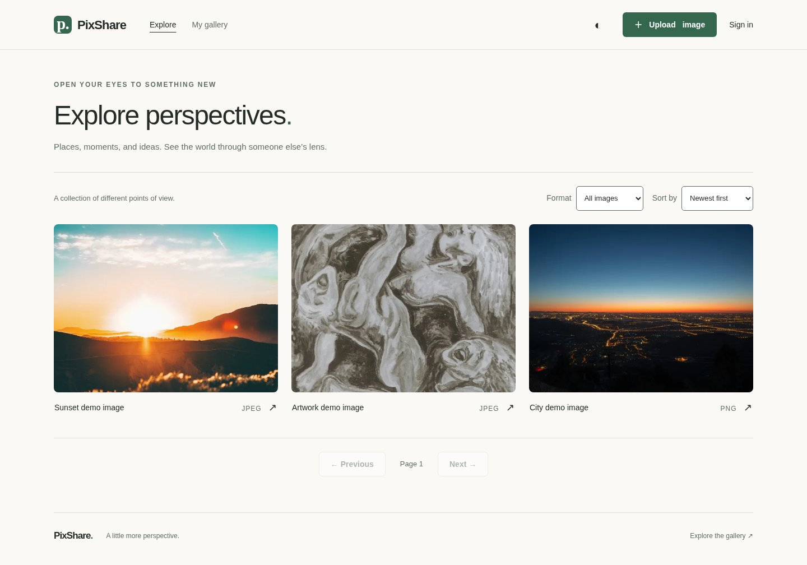
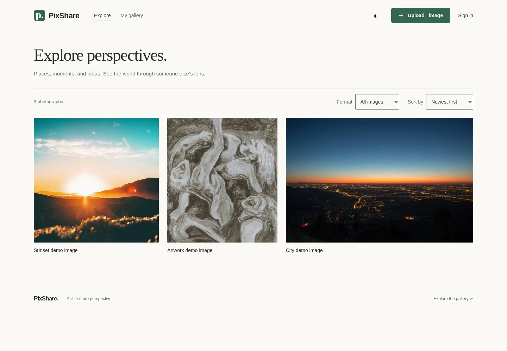

# Editorial Gallery refinement

Historical Explore-only milestone. The subsequent
[final portfolio release](FINAL_RELEASE.md) extends and consolidates this design;
the opt-in component prop described below has since been removed.

Recorded 2026-10-24. This milestone changes **Explore only**. It preserves the
warm off-white/forest palette, existing dark tokens, navigation, accounts, Clerk,
API requests, database schema, original application uploads and storage code.
No dependencies, feature-flag service, commits, pushes or deployments were added.

## Original design problems

The gallery used three equal columns of 4:3 `object-cover` images on desktop and
tablet. At 390px it used a single column, still cropped to 4:3. The square sunset
lost its upper sky and foreground; the portrait lost considerable composition.
Format abbreviations and diagonal arrows competed with single-line captions.
The heading's uppercase introductory label repeated its purpose. Two disabled
pagination buttons remained visible even for a single result or empty filter.

The existing palette, capped shell, predictable source order, native filters,
accessible link descriptions and responsive WebP delivery were worth keeping.
The prior [UX audit](UX_AUDIT.md) and [Phase 8 report](PHASE_8_REPORT.md) informed
the scope; their screenshots were inspected before fresh baselines were taken.

## Hallmark references and direction

The installed **Hallmark 2.0.0** instructions, Codex harness guidance, theme text
and reference pictures for all three requested themes were reviewed.

| Reference | Applied lesson | Elements left out |
| --- | --- | --- |
| Studio | Considered spacing, serif voice, photographs in true color | Crop marks, construction guides, orange, dot grids and new fonts |
| Editorial | Restrained rules, unboxed content, quiet captions and controls | Heavy condensed display, strong section rules and a wholesale theme replacement |
| Darkroom | Photographs carry the screen; dark surfaces stay quiet | Monochrome conversion, amber accents, grain and poster typography |

The selected direction is **The Editorial Gallery**, expressed through PixShare's
existing brand. The Explore title uses the Georgia family already present in
the application. Photography retains its colors and composition. No marketing
hero, generated imagery or new page sections were introduced. The user's scoped
brief takes precedence over Hallmark's new-site scaffolding and clean-tree rules;
the substantial pre-existing working-tree changes were preserved.

### Layout comparison and selected implementation

The alternatives were captured with the same real API records and images:

| Layout | Observed result |
| --- | --- |
| Original uniform grid | Consistent rows, but square and portrait photos are cropped |
| Equal-column grid with native ratios | Entire photos, but shorter landscapes leave conspicuous gaps below them |
| CSS column masonry | Packs vertically; visual rows no longer match keyboard/source order. In the larger collection, the first column contains studies 9, 5, 6 and 11, while the second starts with the long-caption image |
| Selected proportional rows | Flat source-ordered markup, roughly equal image heights within each row, bounded image size, and full composition |

See the [comparison index](editorial-gallery/README.md), especially the larger
collection's [native grid](editorial-gallery/before-dense/desktop-light-alternative-natural-grid.jpg),
[column masonry](editorial-gallery/before-dense/desktop-light-alternative-columns.jpg)
and [selected rows](editorial-gallery/after-dense/desktop-light-explore.jpg).
The alternative layouts are temporary Playwright CSS probes, not shipped modes.

The implementation uses native wrapping flex rows. Each photo's metadata ratio
sets its flex basis, growth and frame ratio. Desktop/tablet rows target 240px
height and cap at 360px; a sparse final row remains left aligned instead of
stretching a single photograph across the page. Row count follows the actual
images, rather than forcing three columns. Below 701px there is one column.
There is no viewport JavaScript, measurement effect, sorting or CSS `order`.

Frame ratios are bounded between 1:2 and 2:1, with 4:3 for legacy records lacking
dimensions. `object-contain` preserves the whole photo even in these bounded
or fallback frames. Exceptional panoramas/tall originals can therefore have
space around them; their composition is not cropped. Responsive source widths
are bounded per photo by its desktop slot; mobile uses the full content width.
The existing `PostImage` WebP selection, lazy loading and original fallback stay
in place. No original files are modified by this frontend behavior.

Captions show up to two lines and reserve equal caption space in desktop/tablet
rows. Long words wrap without expanding the card. Complete captions remain on
the existing detail page, and the existing bounded accessible link names remain
unchanged. Hover changes caption color without dimming or moving the photograph.

The summary reports the actual returned count or page range, without inventing a
total that the array API does not provide. Filters still reset to the first page.
Single-page results have no pagination bar; multi-page results retain native
Previous/Next buttons and their boundary disabled states. A later page retains
Previous during an error so the visitor can recover to an earlier page.
Existing loading, empty, retry and clear-filter behavior remains available.

## Files changed

| File | Purpose |
| --- | --- |
| `web/app/explore/page.tsx` | Opt into the scoped gallery treatment; simplify the introduction |
| `web/components/Gallery.tsx` | Opt-in presentation prop, real result summary and conditional pagination; request/query behavior retained |
| `web/components/posts/PostCard.tsx` | Opt-in metadata ratio, contain fit, responsive sizes, and removal of decorative format/arrow labels |
| `web/app/globals.css` | One existing-family font token, Hallmark record and appended Explore-scoped styles |
| `web/e2e/public.spec.ts` | Two real-data regressions; update the old always-visible-pagination expectation while preserving its sort assertion |
| `web/scripts/editorial-gallery-audit.mjs` | Reproducible public screenshots, layout/keyboard assertions, axe, delays and failure recovery |
| This report and `docs/editorial-gallery/` | Reviewable evidence, screenshot index, measurements and verification record |

`editorial` is an ordinary component presentation prop enabled by this route,
not a runtime rollout flag. The homepage and personal gallery retain their
existing markup paths, card styling and pagination behavior. No backend files,
models, migrations, lockfiles, authentication code or storage code were edited
by this milestone.

## Before and after

| Desktop light, original | Desktop light, refined |
| --- | --- |
| [](editorial-gallery/before/desktop-light-explore.jpg) | [](editorial-gallery/after/desktop-light-explore.jpg) |

| Viewport | Light comparison | Dark comparison |
| --- | --- | --- |
| 1440 × 1000 | [Before](editorial-gallery/before/desktop-light-explore.jpg), [after](editorial-gallery/after/desktop-light-explore.jpg) | [Before](editorial-gallery/before/desktop-dark-explore.jpg), [after](editorial-gallery/after/desktop-dark-explore.jpg) |
| 768 × 1024 | [Before](editorial-gallery/before/tablet-light-explore.jpg), [after](editorial-gallery/after/tablet-light-explore.jpg) | [Before](editorial-gallery/before/tablet-dark-explore.jpg), [after](editorial-gallery/after/tablet-dark-explore.jpg) |
| 390 × 844 | [Before](editorial-gallery/before/mobile-light-explore.jpg), [after](editorial-gallery/after/mobile-light-explore.jpg) | [Before](editorial-gallery/before/mobile-dark-explore.jpg), [after](editorial-gallery/after/mobile-dark-explore.jpg) |

There are **85 JPEGs**: 30 before and 30 after state/viewport/theme captures,
eight larger-collection captures per revision, eight layout-alternative probes,
and one visible keyboard-focus capture. All are actual browser captures. The
[screenshot index](editorial-gallery/README.md) links every capture, including
filtered, empty, loading, error, long captions, legacy images and page two.

The main matrix uses the three bundled real images in a fresh local PostgreSQL
database, `pix_share_editorial_e2e`, on port 55440, with isolated media under
`/tmp/pixshare-editorial/uploads`. The oversized city fixture's disposable copy
was reduced to 1920px, preserving its full composition, so the existing decoder
budget could produce its actual WebP variants. The art fixture's disposable row
was corrected to JPEG, matching its bundled bytes, leaving a genuine empty WebP
filter. The repository's demo files and application data were untouched.

The larger dataset adds twelve isolated copies of those actual photos, including
5,000-character prose/unbroken captions, an empty caption and a legacy original
without metadata. This is stress data, not twelve additional unique photographs.
Successful responses always come from FastAPI/PostgreSQL. Network failures are
aborted requests; loading states delay real responses and then release them.
No successful API response, account or authentication result is mocked.

## Responsive and visual findings

| Size | Observed behavior |
| --- | --- |
| Desktop | The three-photo set becomes approximately 355px square, 313 × 355px portrait and 532 × 355px landscape. The first images begin at y=336, versus y=400 originally |
| Tablet | Larger photos than the former 225 × 169px thumbnails. The full collection forms pairs in the final captured set; a last-row sizing adjustment removed an avoidable single square photo |
| Mobile | One 350px-wide column at 390px. Square frame 350px high, portrait about 398px, landscape about 234px, rather than cropping each to 262.5px high |
| Both themes | Same layout, unchanged brand colors, readable caption contrast, 44px-or-larger main controls, no observed horizontal overflow |

Frames retain identical width, height and document position while actual image
requests are held and then decoded. This establishes image-loading stability
after metadata arrives. The initial query skeleton remains approximate: unknown
photo ratios cannot reserve an exact final page height before data arrives. This
is not a zero-CLS claim. The final tablet density change does not change the
three-photo matrix's capped frames or its loading/empty/error presentation; the
larger-collection captures and full regression run use the final production build.

Independent visual review followed the Hallmark finish prompt **in-thread**, as
its Codex harness guidance specifies. The one actionable density finding was the
tablet orphan, fixed and recaptured. The original did better at uniform thumbnail
scanning and exposing file formats at a glance. The selected version deliberately
gives image composition and caption space priority; format remains a filter and
detail-page fact. No further route refinement is included.

## Accessibility findings

- **PASS:** 38 refined capture-state scans report zero axe WCAG A/AA and
  best-practice violations. The 38 equivalent baseline scans also report zero;
  this is a design improvement, not a claimed repair of an axe failure.
- **PASS:** Actual Tab events visit image links in API/DOM order in all six
  layouts; focus outlines are at least 3px. See the
  [mobile focus screenshot](editorial-gallery/after-dense/mobile-light-focus.jpg).
- **PASS:** Existing concise `View image: …` names and empty enclosed image alt
  text remain; a 5,000-character fixture still has a bounded link name. Entire
  captions remain available through the detail link.
- **PASS:** Main selects/buttons meet the selected 44px target; existing native
  labels, skip link, theme persistence and reduced-motion checks pass.
- **LIMIT:** Axe's `color-contrast` remains inconclusive for the existing brand
  mark in both modes and decorative theme glyph in light mode. The actual token
  pairs were calculated separately; no automated conformance claim is made.

| Rendered token pair | Light | Dark |
| --- | --- | --- |
| Main text / page | 13.72:1 | 14.72:1 |
| Muted text / page | 5.13:1 | 7.95:1 |
| Focus ring / page | 6.31:1 | 10.82:1 |
| Primary text / fill, also used by the brand mark | 6.64:1 | 9.85:1 |

The existing accessibility helper additionally verifies select boundaries against
their adjacent backgrounds at at least 3:1. Inconclusive selectors and calculated
pairs are retained in [accessibility-review.json](editorial-gallery/accessibility-review.json).
Real screen-reader use, forced colors, zoom combinations and physical mobile
devices were not tested in this milestone.

## Verification results

| Check | Result |
| --- | --- |
| Frontend ESLint | **PASS**, existing installed executable over the full frontend |
| TypeScript | **PASS**, `tsc --noEmit` |
| Next.js 16.4.1 production build | **PASS**, final scoped styles compiled and all routes generated |
| Public Playwright Chromium suite | **PASS**, 24 passed, zero skipped, 1.6 minutes, final production build |
| Added composition/layout regression | **PASS** at all three existing device profiles, with real metadata, legacy fallback and delayed image decoding |
| Added pagination regression | **PASS**, real offset 12, page two, boundary buttons, return and format reset |
| Screenshot/state audits | **PASS**, all six target layouts, all five main states, larger collection, variants, keyboard sequence and retry recovery |
| Axe and control contrast | **PASS** for reported violations/boundaries; inconclusive glyph checks disclosed above |
| Hallmark static sweep | **RUN, not a clean global pass**: 11 Floor/51 Reflex before, 9 Floor/50 Reflex after; 2/2 recorded links and 5/5 handlers preserved |
| Hallmark render tier | **NOT RUN**, installed environment lacks `puppeteer-core`; repository Playwright supplies the visual evidence |
| Backend regression tests | **SKIPPED**, no backend-facing request, model, auth, storage or API behavior changed; real public/API auth-boundary browser regressions passed |
| Authenticated Clerk CRUD suite | **NOT RUN**, this milestone exercises public Explore; no authenticated journey was changed |
| Firefox / WebKit | **NOT RUN**, Chromium-only verification; prior host limitations are documented in Phase 8 |
| Scoped whitespace/privacy/link review | **PASS**, no credentials or account screenshots in the delivered evidence |

The remaining Hallmark Floor findings are pre-existing shared CSS: literal
font/color declarations in the body, brand mark, homepage, destructive controls
and dialog backdrop, plus tracked labels used on other routes. Remaining Reflex
findings largely concern existing spacing and homepage type. They were not
silently repaired across the application. The scoped additions use tokens and
introduce no new Floor findings. A full global Hallmark pass would require work
outside this milestone. Shell/theme changes, global clipping and generated token
scaffolding were intentionally excluded by the user's preservation constraints.

Commands used, from `web/` unless specified:

```bash
node node_modules/eslint/bin/eslint.js .
node node_modules/typescript/bin/tsc --noEmit
NEXT_TELEMETRY_DISABLED=1 node node_modules/next/dist/bin/next build

E2E_BASE_URL=http://localhost:3000 \
PLAYWRIGHT_CHROMIUM_EXECUTABLE_PATH=/etc/profiles/per-user/edtosoy/bin/chromium \
node node_modules/@playwright/test/cli.js test \
  --project=desktop --project=tablet --project=mobile

# Three-image fixtures; run each phase against its corresponding build.
EDITORIAL_AUDIT_ISOLATED=1 \
PLAYWRIGHT_CHROMIUM_EXECUTABLE_PATH=/etc/profiles/per-user/edtosoy/bin/chromium \
node scripts/editorial-gallery-audit.mjs before
# Substitute after for the refined build.

# Fifteen-image fixtures, with the original build on port 3001:
EDITORIAL_AUDIT_ISOLATED=1 EDITORIAL_AUDIT_DENSE=1 \
E2E_BASE_URL=http://localhost:3001 \
PLAYWRIGHT_CHROMIUM_EXECUTABLE_PATH=/etc/profiles/per-user/edtosoy/bin/chromium \
node scripts/editorial-gallery-audit.mjs before
# Refined: after, with E2E_BASE_URL=http://localhost:3000.
```

The fixture guards intentionally fail against another dataset. Reproduction
requires a separately migrated/seeded local E2E database with the fixture
conditions above, local storage and an empty WebP result. The audit itself is
read-only. The isolated API's final audit process uses `API_READ_LIMIT=10000` and
local CORS origins for ports 3000/3001. No configuration file or production
security default was changed.

The frontend, baseline-copy frontend, API and disposable PostgreSQL processes
started for this audit were stopped afterward. The isolated database/media and
local execution logs remain under `/tmp/pixshare-editorial`; screenshots and
sanitized measurements remain in this repository's documentation directory.

The initial concurrent browser run hit the default 300-read/minute limit:
12 passed, 5 failed, 1 interrupted, 6 not run. That run was stopped and is not
counted as successful. The final run above passed after adjusting only the test
process's read budget. The first dense baseline attempt used an unallowed port
3001 origin; the corrected local CORS run passed. Initial `pnpm` launches failed
on this workstation's package-manager database/options; the same checked-in
scripts' installed executables were used directly. An initial sandboxed build
could not bind Turbopack's worker socket; moving its generated cache and rerunning
with command-scoped local socket access succeeded. Browser sandboxing remained
enabled. No dependencies or lockfiles changed to resolve these host issues.

Installed Next.js documentation for `Image` was consulted, particularly explicit
ratio reservation, `fill`, `sizes`, empty decorative alt text and lazy loading.
There is no new framework API or image pipeline in this change.

## Remaining design opportunities

1. Review these images with the product owner before extending the treatment.
2. Evaluate more unique real photographer collections. The stress set repeats
   three bundled photos and does not establish visual quality for every ratio
   distribution. Very sparse final rows remain left aligned; extreme ratios
   use bounded, contained frames.
3. Dedicated descriptive alt text and assistive-technology testing remain useful
   future work. This refinement retains the existing caption-based names.
4. Initial query skeletons could eventually use previously known dimensions to
   improve fetch-to-content stability; that would be a separate behavior change.

Homepage, navigation, upload, detail and personal-gallery design are deferred
until the requested review. No additional product features were added.

## Reversal instructions

For a quick gallery rollback, change Explore's `<Gallery editorial />` back to
`<Gallery />`. Its original uniform grid, cover fit, captions, format labels,
arrows and pagination return. Removing `editorial-explore` from this route's
main element also restores the original heading styles. Appended scoped CSS
then has no effect on any route.

For an exact code rollback, reverse this milestone's hunks in the four production
files listed above, including the Explore introductory label/heading and the
new font token. Reverse only this milestone's two added tests and pagination
assertion adjustment in `public.spec.ts`: that file already contained user work
before this task. Remove the new audit script/report/evidence only if no longer
wanted. No data migration, environment change, cloud operation or runtime flag
is needed. Preserve all unrelated working-tree changes.
