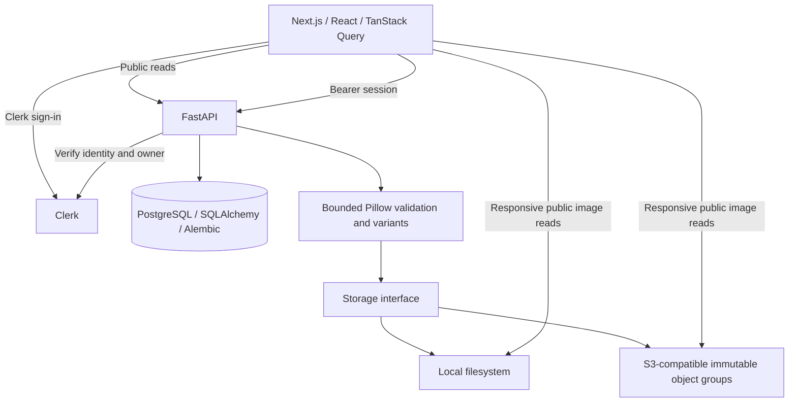

# PixShare: a simple online photo album

[GitHub repository](https://github.com/EdTosoy/PixShare)

PixShare lets people upload photographs, add captions, browse an album and
manage their own images. It is deliberately a small application: the engineering
work is in validating media, authenticating changes, preserving data during
replacement/deletion, and delivering appropriately sized images.

There is no verified public live demo. Screenshots show the actual local
production build with bundled demonstration photographs and dedicated test data.

## The interface

The user selected **Hallmark 2.0's Atelier theme**: Sentient display typography,
Hanken Grotesk body text, warm paper, dark ink, a muted slate accent and thin
photographic mats. There is no forest-green accent. The application stays still;
Atelier's decorative haze, texture and motion are omitted for a focused album.

Photographs retain their color and composition. Responsive proportionate rows
preserve DOM order, captions stay bounded, and mobile uses one column. Upload
and editing place the real file picker beside the caption on larger screens and
stack them in reading order on mobile. Keyboard focus and recovery states stay
visible. Sentient uses Fontshare's official service; Hanken is self-hosted under
OFL. See [font notices](../web/public/fonts/atelier/README.md).

## Architecture

The frontend uses Next.js 16.4.1, React 19, TypeScript, TanStack Query and Tailwind
4. The API uses FastAPI, SQLAlchemy asyncio, Alembic and PostgreSQL. Pillow
validates and resizes media; boto3 implements the optional object adapter.
Docker Compose supplies reproducible local services.

## Engineering challenges

### Trust decoded content, not upload labels

The server checks allowed formats, MIME agreement, byte size, dimensions and
actual Pillow decoding before storing media. A 10 MiB file budget, 16-megapixel
budget and 20,000px edge limit are independent. The request envelope is capped
before multipart spooling; decoding runs outside the event loop under a bounded
per-process work budget.

### Keep replacement and deletion deliberate

Backend owner checks and PostgreSQL row locks serialize concurrent updates and
deletions. A replacement writes new media, commits its database reference, and
only then removes old media. Failed commits clean new uploads. A refresh failure
after commit must never delete the committed replacement. Tests exercise these
failure boundaries; the design does not claim an atomic transaction across the
database and object store.

### Deliver smaller images without breaking originals

The image response adds dimensions and actual-width WebP variants. The browser
selects from `picture` source sets, with lazy gallery loading and an original
fallback if derivatives fail. Variants preserve aspect ratio and compatible color
profiles; originals remain unchanged. New demonstration copies are normalized
separately so fresh setup avoids the historical malformed/oversized seed assets.

[Current response-body measurements](release/image-performance.json) compare
selected representations with the corresponding stored demo originals at DPR 1.
This is a bounded payload observation, not a production latency or LCP claim.
The [earlier optimization report](PHASE_8_REPORT.md) retains its original dataset
and historical measurements separately.

### Authenticate mutations and keep storage replaceable

Clerk sessions are verified by the API. Public reads do not request a token;
mutations require an explicit Bearer token and backend ownership checks. Private
query keys include identity, and the query cache resets on account changes.

Local storage works without cloud resources. S3-compatible writes use immutable
namespaces, private manifests, conditional writes, and bounded SDK retries.
Serialization resolves public locations without exposing credentials. Existing
local records remain readable when new writes switch provider. Real local MinIO
tests verify adapter behavior; they do not establish AWS IAM or CDN correctness.

## Evidence and limits

[Final release verification](FINAL_RELEASE.md) records executed tests, type/lint
checks, build results, accessibility limits, screenshot comparisons and CI links.
[The screenshot index](release/SCREENSHOTS.md) distinguishes signed-out portfolio
captures from authenticated workflow captures with masked avatars.

Pytest includes selected test doubles for deliberate failure cases and real
PostgreSQL/storage integration. The strict browser run uses genuine Clerk
sessions, including account switching, signup, ownership denial, upload, caption
editing, image replacement and deletion. Test accounts and normal application
data remain separate. The CI browser job uses keyless public journeys; it is not
presented as authenticated CI coverage.

Known limits include public original metadata, no private albums or moderation,
per-process rate limits, offset-page drift, possible cross-system orphans, no
production capacity claim, no hosted cloud verification and no complete
screen-reader certification. No live-demo URL is advertised.
