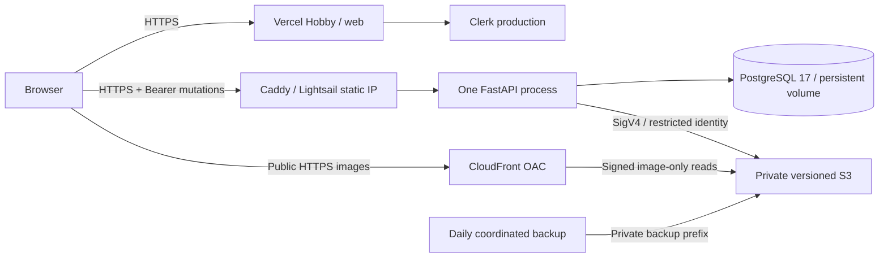

# Terraform deployment of the PixShare portfolio demo

Prepared 2026-10-25. **Files prepared; live deployment on hold at the user's
request. No AWS resources, DNS records, IAM credentials, Vercel projects or live
URLs were created for this task.** Local verification is recorded below and must
not be substituted for hosted acceptance.

Application release: **`7bcac0f151c6b4773533238dfe11b0b5fd4659b5`**. The checkout
began clean at `3b71166`, which adds image titles. Workflows check out the requested
application release separately from deployment tooling; they do not deploy the
newer UI accidentally. Record the final tooling commit separately after review
and publication. No application code, lockfiles, migrations or existing accounts
are changed by these files.

Earlier [runbook](DEPLOYMENT_RUNBOOK.md), [Phase 10](PHASE_10_REPORT.md),
[Phase 11](PHASE_11_REPORT.md), [final release](FINAL_RELEASE.md) and
[production configuration](../.env.production.example) were reviewed. Their
historical local results remain historical. This document replaces the more
expensive Render staging proposal for this particular demo; it does not claim
that the old production gates have been passed.

## Architecture and cost



One Ubuntu 24.04 Lightsail IPv4 Linux bundle, `small_3_0`, Singapore
`ap-southeast-1`. Verify the actual active bundle/blueprint, 2 GB RAM and $12 price
in that account before approving any plan. Terraform provisions a static IPv4
and opens TCP 80/443 plus SSH only from owner-specified IPv4 CIDRs (/32 preferred).
There are no public PostgreSQL or API container ports. DNS is managed separately
by the existing `edtosoy.com` owner; no Route 53 resources or other AWS accounts
are involved. Media uses CloudFront's own HTTPS hostname, avoiding another domain
or certificate requirement.

Conservative **planning allowances**, monthly USD before tax, low traffic:

| Item | Gross planning allowance |
| --- | ---: |
| Lightsail 2 GB IPv4 Linux, included disk/transfer | $12.00 |
| Attached static IPv4 | $0 while attached |
| S3 current images, retained versions, daily backup archives, requests | $1.00 |
| CloudFront requests and delivery | $3.00 |
| Dedicated S3 Terraform state, versions and lock requests | $0.10 |
| One notification-only AWS Budget | $0 assumed; confirm current billing terms |
| **Planning total** | **$16.10 + tax** |

Assume ≤0.4 GB current media, ≤0.5 GB per full backup, 14 current daily archives,
30 days of noncurrent versions, ≤10 GB/month CDN delivery, ≤100,000 image GETs,
and no Lightsail transfer overage. Backup scripts cap one archive's uncompressed
payload at 512 MiB and fail rather than silently dropping data. S3 version
retention can increase the stored total beyond 14 archives. These are workload
assumptions and allowances, not an account-specific AWS Calculator quote.
Price Class 200 includes Asian edge locations. No introductory credits, CloudFront
free allowance or promotional Lightsail trial is deducted from gross costs.

Vercel Hobby is $0 only for an eligible personal/noncommercial demo within its
limits. Clerk must stay within its included production usage. Existing domain
registration is excluded. No RDS, NAT, ALB, ECS, EKS, Kubernetes, paid runner,
automatic instance snapshot or new monitoring subscription is introduced.
Use an existing trusted admin machine for delivery, not a new paid server.

The real gross estimate, including applicable taxes and existing account charges,
must stay **below $20** before apply. Traffic, abuse, historical objects and idle
IPs can exceed the estimate. Stopping Lightsail does not stop its instance
charges. A detached static IPv4 can incur an hourly charge. Budget alerts are
delayed notifications, **not a hard cap or automatic shutdown**.

## Remaining manual work, in order

1. **Account owner:** configure only `pixshare-trial` locally. Confirm the exact
   account with the brother who owns/authorizes it; never use the personal AWS
   account. Confirm plan, available credits, expiry, service restrictions and
   permissions. Put account identifiers/evidence only in private working files.
2. **Billing owner:** confirm current prices/taxes and credit applicability,
   approve the gross estimate, notification recipients and teardown date before
   credit expiry. Verify that billing notifications reach the owner.
3. **Operator:** create/review private tfvars and public SSH key, bootstrap the
   budget/state bucket, protect bootstrap state, then initialize the demo's
   backend with both the intended bucket and allowed account ID.
4. **Plan reviewer:** inspect the entire live plan and cost estimate; explicitly
   approve that saved plan. No apply has been authorized by the preparation checks.
5. **DNS owner:** confirm control of `pixshare.edtosoy.com` and
   `api.pixshare.edtosoy.com`. Later create the API A record from Terraform's
   static IP output and the frontend records provided by the dedicated Vercel
   project. Verify any CAA records permit Caddy's ACME issuers. No wildcard DNS.
6. **Clerk owner:** create/select the intended production instance, complete its
   DNS/TLS and sign-in settings, and privately supply matching live keys. Use two
   fresh demo accounts; never import development identities or rewrite ownership.
7. **Secrets operator:** create the two narrowly scoped storage credentials
   outside Terraform and provision the private host files below. Review/rotate
   them regularly. Record the SSH host fingerprint through a trusted channel.
8. **GitHub owner:** review/publish the tooling and lockfiles, configure protected
   environments, GHCR access and a trusted admin runner. Do not enable delivery
   for an unreviewed branch or allow arbitrary workflows to use that runner.
9. **Vercel owner:** create the dedicated Hobby project with root directory
   `web`, verify the intended owner/project, set production configuration and
   domain, and disable automatic Git deployments. Configure the workflow's token
   and project/organization IDs privately.
10. **Release operator:** obtain a passing fresh vulnerability gate, deliver the
    exact API release, then stage/promote the Vercel artifact after review.
11. **Acceptance operator:** run live auth/media/ownership/restart and offsite
    restore/rollback checks. Only then record resources and URLs as successfully
    deployed. Keep a dated teardown reminder before credit expiry.

If any account/credit/permission/configuration/cost check fails, stop. Do not
upgrade the account plan, expand IAM access or fall back to another account to
make the plan work.

## AWS identity, credit and permission checks

The attempted command in this task was
`aws --profile pixshare-trial --region ap-southeast-1 sts get-caller-identity`.
It returned **"The config profile (pixshare-trial) could not be found"**. No AWS
identity, ownership, plan, credit balance, expiry or service permissions were
verified. Further live account work was explicitly put on hold by the user.

After the owner configures the profile, run these in a private terminal. Never
paste raw account/billing output into GitHub or this document:

```sh
aws --profile pixshare-trial --region ap-southeast-1 sts get-caller-identity
aws --profile pixshare-trial --region us-east-1 freetier get-account-plan-state
aws --profile pixshare-trial --region ap-southeast-1 lightsail get-bundles
aws --profile pixshare-trial --region ap-southeast-1 lightsail get-blueprints
aws --profile pixshare-trial --region ap-southeast-1 lightsail get-regions --include-availability-zones
aws --profile pixshare-trial --region ap-southeast-1 s3api list-buckets
aws --profile pixshare-trial --region us-east-1 cloudfront list-distributions
```

The Free Tier API can return plan/status, remaining credits and expiry for newer
accounts. Older promotional credits or denied billing access may require the
owner's Billing console. An unreadable balance is unverified, not zero or free.
Read access does not prove create permissions. Review/verify required Lightsail,
S3, CloudFront, IAM and Budgets management permissions under the trial identity;
a plan cannot establish all apply-time permission/service restrictions.

Unset inherited AWS access-key/session/web-identity/role variables before running
Terraform. Both provider blocks fix `profile = "pixshare-trial"` and
`allowed_account_ids`; the demo backend also fixes that profile and requires its
own account allowlist. Never use `-backend-config` credentials, `skip_*` auth
checks or an alternate AWS endpoint to bypass an identity failure.

## Bootstrap, state and plan approval

Terraform ≥1.10 and <2; AWS provider **6.70.0**, exact pin and generated checksum
lockfiles in both roots. Keep both lockfiles in the published tooling revision.
No application credentials, private keys, access-key resources, secret-manager
secret values or TLS private keys enter Terraform. An imported operator **public**
SSH key is the only key material in the configuration/state.

Bootstrap deliberately uses local state initially. Run from encrypted storage
with `umask 077`, protect the local state/backup, then store an offsite encrypted
copy. It contains account metadata and notification addresses even though it
contains no application secrets. Create budget notifications before chargeable
infrastructure: the state bucket depends on the budget, and the demo preflight
requires confirmed notification delivery.

```sh
umask 077
cp infra/terraform/bootstrap/terraform.tfvars.example infra/terraform/bootstrap/terraform.tfvars
# Privately fill actual owner-confirmed values. Leave flags false until verified.
terraform -chdir=infra/terraform/bootstrap init -lockfile=readonly
terraform -chdir=infra/terraform/bootstrap plan -out=bootstrap.tfplan
# Review the complete private plan; obtain approval before the following action.
terraform -chdir=infra/terraform/bootstrap apply bootstrap.tfplan
```

Confirm the account-wide $20 budget in Billing and actual notification recipients.
Thresholds are $10/$16/$20 actual and $20 forecast, including taxes and excluding
credits/refunds. There is no spending-stop action. Only then proceed:

```sh
cp infra/terraform/environments/demo/terraform.tfvars.example infra/terraform/environments/demo/terraform.tfvars
cp infra/terraform/environments/demo/backend.hcl.example infra/terraform/environments/demo/backend.hcl
# Fill private files, verify every preflight attestation and current gross quote.
terraform -chdir=infra/terraform/environments/demo init -reconfigure -lockfile=readonly -backend-config=backend.hcl
terraform -chdir=infra/terraform/environments/demo fmt -check
terraform -chdir=infra/terraform/environments/demo validate
terraform -chdir=infra/terraform/environments/demo plan -out=demo.tfplan
terraform -chdir=infra/terraform/environments/demo show demo.tfplan
# ONLY after the owner approves this exact plan:
terraform -chdir=infra/terraform/environments/demo apply demo.tfplan
```

Do not use `-auto-approve`, targeted applies, fabricated attestations or mock-test
values for real infrastructure. Plans contain private settings; do not publish
them. Re-plan/reapprove after changes to the source, variables or account state.

The remote backend is private, AES256 encrypted and versioned, with
`use_lockfile = true`; no DynamoDB. Backend access needs scoped ListBucket,
GetObject/PutObject for the state key and GetObject/PutObject/DeleteObject for
its `.tflock` key. State delete/version-delete should be separately restricted.
Application and backup users have no access to the state bucket.

Optionally migrate bootstrap state to the same bucket under a different key:
back up its local state first, replace **only** bootstrap's `backend "local" {}`
with an S3 block using a distinct `pixshare/bootstrap/terraform.tfstate` key,
the same fixed profile/region/locking, and an owner-verified allowlist. Review the
change and run `init -migrate-state`; retain the offline bootstrap recovery copy.
Do not point both roots at the same key. Keep the backend until all other resource
cleanup and final state archival are complete.

State recovery: stop all writers, save the current state privately, inspect S3
version history as the authorized state operator, retrieve the known-good version
to encrypted local storage, and compare its lineage/serial/resources with AWS.
Use reviewed `terraform state push` only when it is the correct recovery; never
force a stale state over active infrastructure. Force-unlock only after verifying
no Terraform operation owns the lock. No automated stale-lock deletion.

## Host configuration and credentials

`deploy/lightsail/compose.yaml` is a separate production stack, not the development
Compose file. Cloud-init installs Docker/Compose and creates empty protected
directories. It contains no secrets, repository credential or automatic app start.
Wait for `cloud-init status --wait` and inspect its status before delivery.
Keep Ubuntu/Docker patched; distribution package versions are resolved at setup
and are not a byte-for-byte host-image reproducibility guarantee.

PostgreSQL persists in `pixshare_demo_postgres` on the included disk. API legacy
uploads, Caddy certificates and Caddy configuration have persistent named
volumes. There is no `down -v` in deployment or backup scripts. PostgreSQL uses a
non-superuser `pixshare` application role; an administrator password is separately
mounted through a Docker secret file. Initialization only runs on a new empty
volume. A DB role/schema owner handles the existing migrations without granting
the API database-administration privileges.

One API worker / four concurrent requests, 896 MiB API / 384 MiB PostgreSQL /
128 MiB Caddy limits leave host headroom. Operations containers are also bounded.
API/Caddy are read-only with bounded tmpfs, dropped capabilities and rotated
logs. Containers restart `unless-stopped` after host/Docker restarts; unhealthy
status alone does not automatically restart a running container. Daily backups
cause a brief write outage. These are initial portfolio limits, not load-tested
capacity or high availability.

Caddy terminates API TLS, redirects HTTP, limits requests to 11 MiB, and bounds
body/response time. It replaces forwarded client/protocol/host headers; Uvicorn
trusts only Caddy's fixed private address. Check the selected Docker subnet does
not overlap the host/VPN before setup. Disable unneeded HTTP/3/UDP ingress.
Do not expose the Caddy admin API. The database uses an internal Docker network
on the same VM without TLS; this is a documented single-host trust boundary,
not an externally authenticated TLS connection.

**Lightsail is not EC2 instance profiles.** Its create-instance API and the
provider schema have no profile attachment. Terraform creates two IAM users
and policies but **no access keys**. For this small demo an authorized operator
creates/rotates their keys out of band, using a secure secret manager/transfer.
The app user has only media-prefix Get/Put/Delete and prefix-limited List; the
backup user can inventory/read media versions and write/read the private backup
prefix, without deleting retained versions. Both are restricted to the instance's
static IPv4. No console login, bucket-policy management or state access is granted.

This choice introduces long-lived credentials; short sessions without a refresh
mechanism would stop uploads when they expire. No unsupported instance role or
fake OIDC refresh is claimed. IAM Roles Anywhere is a possible future credential
mechanism but its PKI/refresh work is outside this deployment. Review/rotate
both credentials, use overlap during rotation, then revoke old keys. Store no
root/account-owner credentials on the VM. Removing the app's environment after
injection does not remove keys from Docker's privileged inspection surface;
root/Docker administrators remain trusted.

Privately provision these as root-owned regular files with mode **0600**:

| Host file | Contents / source |
| --- | --- |
| `/etc/pixshare/compose.env` | From `deploy/lightsail/compose.env.example`; public immutable images, paths and private ACME contact |
| `/etc/pixshare/api.env` | From API example: exact HTTPS origins, matching live Clerk secret, encoded application DB URL, media bucket/CDN and app-only S3 credentials |
| `/etc/pixshare/backup.env` | From backup example: bucket/region and separate backup credential only |
| `/etc/pixshare/postgres_password` | Random strong database administrator password |
| `/etc/pixshare/app_password` | Different random password matching `DATABASE_URL` |

Generate passwords in the secret store/private session, never in cloud-init,
Terraform variables, CI command arguments or this document. Prefer a long random
hex application password to avoid dotenv/URL escaping ambiguity. Never print
`docker compose config` or container environment objects with working secrets.
For routine validation use `config --quiet`. Host Docker authentication, if GHCR
is private, uses a separate pull-only credential configured privately by the
operator; no registry token is embedded in deployment bundles.

## Application delivery and rollback

The new workflows are `deploy-demo-api.yaml` and `deploy-demo-web.yaml`. Both are
manual dispatch from `main`, restricted to this repository, with exact release
SHA checks. They must be reviewed and published before GitHub can run them.
No workflow has been dispatched for this task.

Configure environment reviewers/branch restrictions for `pixshare-demo-build`,
`pixshare-demo` and `pixshare-demo-live` before enabling delivery. Reviewers must
approve the exact tooling/release, cloud plan and live promotion. Repository
administrators and self-hosted runners are privileged: never run untrusted PR
jobs on the deployment runner, and do not install it on the production VM.

API delivery builds once from `7bcac0f` and scans the actual API, pinned PostgreSQL
and pinned Caddy images with Trivy. Unaccepted High/Critical findings fail the
gate; no ignore-unfixed or blanket exceptions are used. Phase 11 documented
unresolved OS findings; a new successful scan or explicit per-finding remediation/
review is required. Do not change the tested application silently to bypass it.
Raw scan/SBOM artifacts contain no runtime environments; retain them and the
registry digest. Publish only after the gate; deploy via `image@sha256:...`.
Keep the digest's registry artifact and previous compatible artifact; never
delete/rebuild a rollback image or rely on a mutable tag.

The SSH job uses an existing trusted machine with the `pixshare-deploy` runner
label, an allowed administration /32, pinned host keys and a dedicated private
key in GitHub's protected secrets. Standard GitHub-hosted runners have changing
egress; the workflow does not open SSH globally to accommodate them.

Required protected GitHub configuration (names only):

| Target | Variables / secrets |
| --- | --- |
| API build | `GITHUB_TOKEN` package-write scope only in build job |
| API deploy | variable `DEMO_SSH_HOST`; secrets `DEMO_SSH_PRIVATE_KEY`, `DEMO_SSH_KNOWN_HOSTS` |
| Web stage/promote | variables `VERCEL_ORG_ID`, `VERCEL_PROJECT_ID`, exact `VERCEL_CLI_VERSION`; secret `VERCEL_TOKEN` |

Use a reviewed exact Vercel CLI (official npm metadata reported 65.2.0 during
preparation) and verify its behavior before delivery. The dedicated project has
Root Directory **`web`**; Vercel commands run from the checked-out repository root
so the project root setting is applied once. They verify the pulled project/org
IDs and rootDirectory before building. Install Node 24 and pnpm 11.11.0.

Set these in that Vercel project's **Production** environment before the build:
`PIXSHARE_ENVIRONMENT=production`,
`NEXT_PUBLIC_API_URL=https://api.pixshare.edtosoy.com`, the production
`NEXT_PUBLIC_CLERK_PUBLISHABLE_KEY`, `/sign-in`, and `/me` redirect fallbacks.
Server-only configuration includes matching `CLERK_SECRET_KEY` and
`CLERK_AUTHORIZED_PARTIES=https://pixshare.edtosoy.com`.
Never put secrets in `NEXT_PUBLIC_*`. The workflow pulls/builds production,
stages with `--skip-domain`, and promotes that same artifact in a separate
protected job. It never uploads `.vercel` environment files. Disable automatic
Git deploys so unrelated `main` changes do not replace the pinned release.

On the host, the root deployment script serializes operations with a lock,
checks private file ownership/mode, pulls the digest, waits for PostgreSQL, runs
`alembic upgrade head` once, then checks API readiness before starting ingress.
No automatic downgrade, seed import, user migration, backfill or destructive
schema operation is included. The existing migration head remains `cdae1ace538f`.
After HTTPS readiness it records `current` and preserves a distinct `previous`
release directory. Failures leave the candidate and private evidence for review;
they are not silently retried as successful mutations.

Rollback, only after reviewing schema/configuration compatibility and writer
state: use the **retained previous bundle and digest**, run its reviewed
`deploy.sh` with its directory, and verify HTTPS/persistence. This will only run
existing compatible upward migrations, never downgrade. Use Vercel's retained
immutable production deployment (`vercel rollback PREVIOUS_DEPLOYMENT_URL`) for
frontend rollback; confirm owner/project first. The first deployment has no
previous release, so it cannot establish a rollback rehearsal. Establish a second
compatible retained deployment and measure it before claiming that gate passed.
The Phase 8 image `632b15c` is not S3 compatible and is ineligible.

## Backup, recovery and limitations

Install the provided root systemd backup service/timer with deployment. At 18:00
UTC daily (with small jitter), `backup.sh` obtains the same operations lock,
stops/drains the only API writer, takes a PostgreSQL 17 custom-format dump and
ordered full-row fingerprints, then captures **all current media objects,
private manifests, version IDs, content metadata and legacy files**. It creates
an archive with SHA-256 checksums for every file. After snapshot creation, it
attempts to resume the API even on errors, verifies the archive, and uploads it to the
private `pixshare/backups/` prefix with SSE-S3 and checksum metadata.

```sh
# On the configured Lightsail VM, after approval:
sudo bash /opt/pixshare/current/backup.sh
sudo systemctl list-timers pixshare-backup.timer
# Use the exact run directory printed/recorded privately by the operator.
sudo bash /opt/pixshare/current/restore-check.sh /var/backups/pixshare/REVIEWED_RUN
```

The restore drill uses a new bounded PostgreSQL container with **no network and
no published ports**. It restores the dump and compares fingerprints of every
users/posts row. It removes only its own temporary container/tmpfs on exit; it
never restores over the live database or deletes application volumes. Verify
archive/media checksums before using it. The run scripts do not delete local
backup directories automatically; the operator must monitor/prune reviewed old
runs to avoid filling the included disk. Failed runs are kept for investigation.

Before launch, additionally **download a backup from S3**, compare its recorded
SHA-256, verify it in an empty working directory with the operations container,
and perform the restore drill. A metadata HEAD after upload and a local archive
check do not prove offsite retrieval works. The archive contains all current
media bytes and their original durable keys/metadata, so recovery does not depend
only on expiring historical object versions.

For real recovery: pause writers, restore into an isolated database/filesystem,
validate rows/owner IDs, hashes and migration head, and use a separate authorized
restore operator to replay archived objects to the **original** bucket/keys with
recorded metadata (or approve an explicit reference migration). Restore legacy
files to a fresh volume with UID 10001. API/backup credentials intentionally
cannot create buckets, alter policy or delete versions. Never point a restored
copy at live write targets for an unapproved drill. Only switch the app after
reviewed cutover and repeat auth/media verification.

Private backup archives expire after 14 days, noncurrent versions after 30 days.
Current active media has **no age expiration**; incomplete multipart uploads are
aborted after one day. This is a same-region/same-account off-host backup, not
cross-region/account disaster recovery or immutable object lock. Target RPO 24h /
RTO 2h is unverified until measured. Account closure or compromise can lose both
the app and backups; keep an encrypted copy outside the trial account before
its expiry. Keep working secrets separately recoverable. Root/container admins
can read backup data and credentials; restrict them accordingly.

No continuous monitoring or paging integration is configured. Review timer exit
status, disk usage, Docker memory/health, readiness, storage cleanup warnings and
Billing regularly; verify the chosen owner's notification procedure. Budget mail
does not alert on backup failures. Restore capacity is bounded for the demo and
can be insufficient once the dataset grows.

## Live acceptance — not run

Use new dedicated production demo accounts and isolated, disposable photos.
Do not point destructive pytest fixtures or the local development E2E suite at
these services. The existing staging runner hard-codes `pixshare/staging` and is
**not directly compatible with the `pixshare/demo` namespace**; do not bypass
its guard or claim it ran. Perform the following real-browser/operator checks
with private evidence before declaring success:

| Check | Required evidence |
| --- | --- |
| HTTPS/public gallery | Canonical frontend and API HTTPS 200; HTTP redirects; responsive gallery from actual API |
| Private boundary | `/users/me` unsigned 401; mutation Bearer requirement; correct CORS/Host handling and spoofed-forwarded-header behavior |
| Clerk | Real sign-up, verification, sign-in, sign-out and session renewal for two new distinct production accounts |
| Upload/media | UI upload 201, durable S3 record, browser-selected WebP, original fallback, correct MIME and SHA-256 |
| Private S3/OAC | Direct anonymous S3, CDN manifests/backups/listing/writes denied; exact CDN image GET/HEAD succeeds |
| Edit/replace/delete | Caption edit; replacement immutable key; old group removed after commit; delete removes row/current origin group |
| Ownership | Other account cannot edit/delete; actual API PATCH/DELETE 403 and unchanged owner data |
| Restart persistence | Known post/owner/media hash survive API, PostgreSQL and host restart; `/ready` recovers |
| Recovery | Fresh S3 download, archive checksums, isolated DB restore, matching complete rows and media; measured recovery time |
| Rollback | Two retained S3-compatible image digests and Vercel artifacts; previous artifact starts and preserves known data |

Originals retain EXIF/GPS and public CDN/browser caches can outlive deletion for
up to the immutable cache TTL. Versioning retains historical deleted bytes until
retention expires. This is a public portfolio album, not private storage.
CloudFront OAC secures its origin; it does not make image URLs private. No WAF
or shared edge-rate-limit service is purchased. The single API's bounded limiter
is a fallback that resets on restart; Caddy supplies body/time bounds, not a
distributed abuse service. Public API exposure and limited availability must be
explicitly accepted for this low-traffic demo.

## Teardown without accidental data loss

Stopping the instance is not teardown. Before expiry: disable delivery/timers,
pause writes, obtain and restore-test a final coordinated backup, copy it and
separate secrets outside the trial account, and record retained registry/Vercel
artifacts. Remove/redirect application DNS only with its existing owner.

`prevent_destroy` protects the Lightsail instance's database disk, media bucket
and state bucket; `force_destroy = false` prevents Terraform from emptying a
bucket. Consequently a normal destroy plan will **refuse data loss**, by design:

```sh
terraform -chdir=infra/terraform/environments/demo plan -destroy -out=destroy.tfplan
# STOP at destruction guards; complete backup/export and obtain explicit approval.
# After approved source edits removing the relevant prevent_destroy guards only:
terraform -chdir=infra/terraform/environments/demo plan -destroy -out=destroy.tfplan
# Inspect/reapprove the full plan. Apply only that approved destruction plan:
terraform -chdir=infra/terraform/environments/demo apply destroy.tfplan
# Interactive equivalent after the same review: terraform ... destroy
```

First export retained data; then an owner can explicitly empty **only the dedicated
demo bucket**, including every version, delete marker and incomplete multipart
upload. Never use a broad account-wide deletion script. An empty current listing
is not an empty versioned bucket. Terraform intentionally does not do this for
you. Revoke/delete out-of-band IAM access keys separately before destroying the
users; `force_destroy = false` makes key-bearing users fail safely. A failed
destroy can be partial: inspect state and AWS before retrying.

Confirm the CloudFront distribution is disabled/deleted, static IP detached **and
released**, Lightsail instance gone and no manual snapshots/disks remain. Check
Billing for final charges and continue budget notifications until billing settles.
Vercel domains/project, Clerk production demo accounts/instance, GitHub runner,
deployment secrets and retained packages are separate cleanup operations; delete
only those created for this demo with owner approval. Do not touch development
accounts, unrelated DNS or the personal AWS account.

Archive state and teardown evidence privately. Remove the budget and the protected
state bucket **last**, via a separately reviewed bootstrap destruction; keep
state history until resources are reconciled. Do not delete a bucket that is
still the active backend. If bootstrap was migrated, first migrate its state to
protected local storage; review/destroy from that configuration. No cleanup
operation has been executed for this task.

## Verification record

Local checks are recorded after completion in this section. A mock plan is never
a live plan; local Docker checks are never production/Clerk/AWS verification.

| Executed local check | Result |
| --- | --- |
| `terraform fmt -check -recursive infra/terraform` | **PASS** |
| `terraform init -backend=false -input=false -lockfile=readonly` in both roots | **PASS**, official provider installed; lockfiles generated by the first init |
| `terraform validate` in both roots | **PASS** |
| `terraform test` in bootstrap / demo | **PASS — 2 + 6**, credential-free mock plans; no AWS resources |
| Production `docker compose ... config --quiet` | **PASS**, disposable example inputs only |
| Pinned Caddy 2.11.7 `validate` | **PASS**, no certificates/server started; Caddy also formatted its file |
| Actionlint 1.7.12 with ShellCheck / standalone ShellCheck 0.11.0 | **PASS**, both new workflows and all new shell scripts |
| `python -m unittest discover -s deploy/lightsail -p test_backup.py` | **PASS — 7**, archive integrity/path/link/duplicate/release checks |
| PostgreSQL local integration | **PASS**, pinned PostgreSQL 17; separate private fixture/volume; no host DB port; non-superuser app role; real existing Alembic migrations; complete users/posts row fingerprints match restored dump; rows survive DB restart |
| Backup archive with actual disposable database dump | **PASS**, SHA-256 validation and extraction into a separate restore-only directory |
| Pinned Trivy CLI gate capability | **PASS**, actual `convert` supports severity filtering and nonzero security-gate exit status; this is not an image scan |
| Locked Ruff `check .` / repository basedpyright | **PASS / PASS**, 0 type errors, warnings or notes; native Nix launchers as described below |
| `git diff --check` | **PASS** |
| New-content privacy / changed-document local links | **PASS**, 42 changed/new files; compared against configured private values without printing them; pre-existing README local/test DB examples were excluded from new-content findings |

The local PostgreSQL drill used the existing local API container only to run
unchanged migrations; a Git comparison confirmed its backend/migration inputs
match `7bcac0f`. It did not certify a newly published release image. Both drill
containers and only their dedicated test volume/network were removed. Existing
development services/accounts/volumes were preserved. Host systemd installation,
root deployment paths, offsite S3 upload/download and the live restore script
remain unexecuted until an authorized host exists.

Initial environment/tooling issues were corrected without weakening checks:
the NixOS wheel launchers needed the installed glibc loader for locked Ruff and
an available basedpyright launcher; the firewall test needed explicit empty
IPv6/alias sets so its entire rule set was known during planning. The actual
PostgreSQL setup verified a root wrapper for file-backed secrets before the
official entrypoint drops privileges. An archive verifier now publishes restore
inputs only after every media checksum passes.

- AWS STS: **BLOCKED**, profile missing; subsequent account work on user hold.
- Live `terraform plan` / `apply`, GitHub dispatch, Vercel/Clerk/DNS configuration,
  production smoke, restart, recovery and rollback: **NOT RUN**, manual work held.
- Actual cloud resources created: **none**. Verified live deployment URLs: **none**.

## Official references checked

- [AWS provider 6.70.0](https://registry.terraform.io/providers/hashicorp/aws/6.70.0/docs)
  and [Lightsail instance](https://registry.terraform.io/providers/hashicorp/aws/6.70.0/docs/resources/lightsail_instance).
- [Terraform S3 backend](https://developer.hashicorp.com/terraform/language/backend/s3)
  and [mock-provider test limitations](https://developer.hashicorp.com/terraform/language/tests/mocking).
- [Lightsail prices](https://aws.amazon.com/lightsail/pricing/),
  [static-IP fees](https://aws.amazon.com/lightsail/faq/),
  [S3 prices](https://aws.amazon.com/s3/pricing/),
  [CloudFront prices](https://aws.amazon.com/cloudfront/pricing/),
  [Budgets prices](https://aws.amazon.com/aws-cost-management/aws-budgets/pricing/).
- [Free/Paid plan rules](https://docs.aws.amazon.com/awsaccountbilling/latest/aboutv2/free-tier-plans.html)
  and [GetAccountPlanState](https://docs.aws.amazon.com/cli/latest/reference/freetier/get-account-plan-state.html).
- [Lightsail create-instance parameters](https://docs.aws.amazon.com/cli/latest/reference/lightsail/create-instances.html),
  [CloudFront OAC and private S3](https://docs.aws.amazon.com/AmazonCloudFront/latest/DeveloperGuide/private-content-restricting-access-to-s3.html).
- [Caddy reverse-proxy header handling](https://caddyserver.com/docs/caddyfile/directives/reverse_proxy),
  [Caddy global timeouts](https://caddyserver.com/docs/caddyfile/options),
  [Docker Ubuntu installation](https://docs.docker.com/engine/install/ubuntu/).
- [GitHub secure Actions use](https://docs.github.com/en/actions/reference/security/secure-use),
  [Vercel project root](https://vercel.com/docs/builds/configure-a-build#root-directory)
  and [Vercel staged deployments](https://vercel.com/docs/cli/deploy).
